<div align="center">

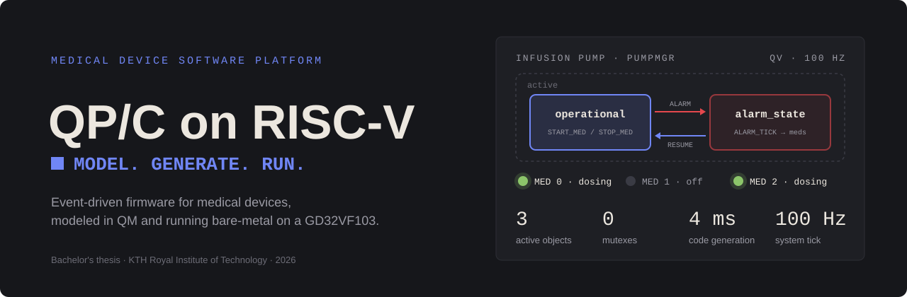

**A platform for medical device software: an event-driven framework, model-based code generation and an open RISC-V microcontroller.**

## [Read the thesis (PDF)](Preliminary%20report/Examensarbete.pdf)

📽️ [Slides from the presentation, 4 June 2026](Preliminary%20report/Presentation.pdf)


<br>


[Why](#why) · [How it works](#how-it-works) · [The demo](#the-demo) · [RISC-V port](#risc-v-port) · [Results](#results) · [Get started](#get-started) · [Team](#team)

</div>

<br>

<table>
  <tr>
    <td align="center" width="50%">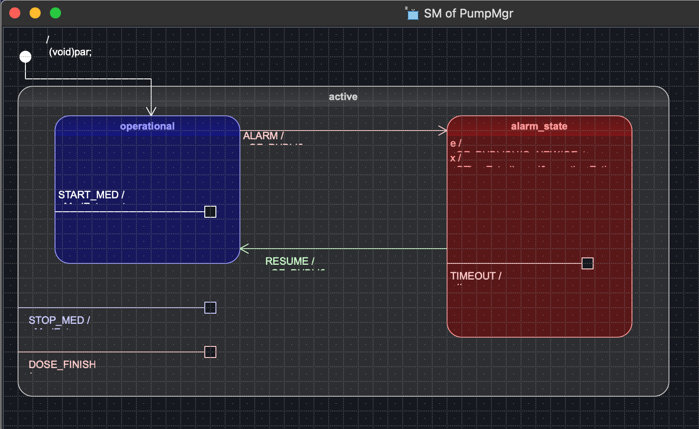<br><sub><b>PumpMgr</b>: the pump's control system</sub></td>
    <td align="center" width="50%">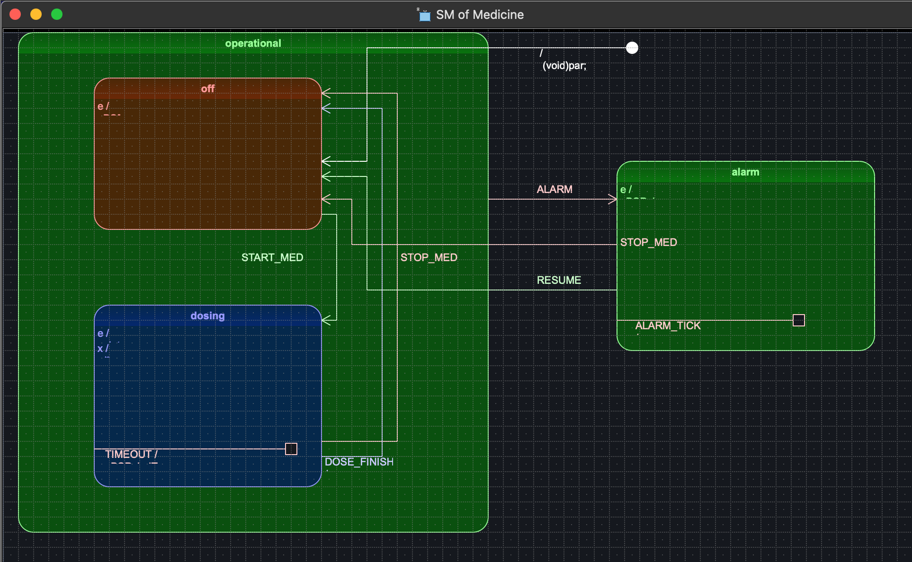<br><sub><b>Medicine</b>: one per dosing channel</sub></td>
  </tr>
</table>

<br>

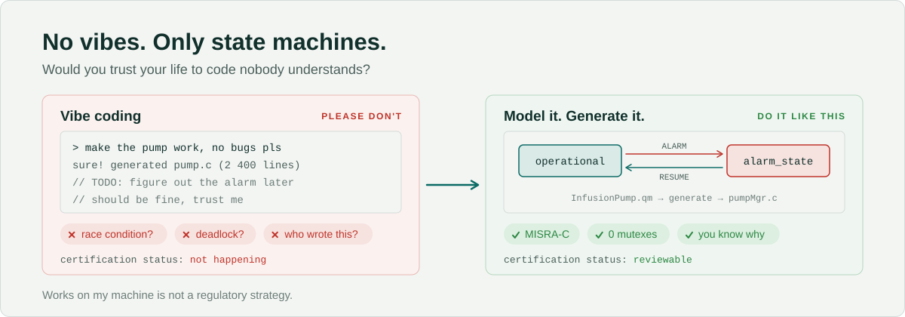

> ### 💬 *"Don't let AI write code you don't understand. Instead, describe the design in a formal language and generate the code from it, so the code can be formally approved."*

That's the idea behind this platform: the **QM model is the formal design**, and the C code is generated from it, so you always know why the code does what it does.

<br>

<p align="center"><sub>⬇️ Click a section below to open it ⬇️</sub></p>

---

<a id="why"></a>
<details>
<summary><h1>🩺 Why this platform?</h1></summary>
<br>

Medical devices range from a plaster to a ventilator, and software faults in them can be life-threatening. That is why regulatory requirements and international standards control how they are built. Every prototype is tested, documented and verified against those requirements.

<table>
  <tr>
    <td align="center" width="33%">🐢<br><b>Slow</b><br><sub>Validation goes through many rounds of testing and documentation.</sub></td>
    <td align="center" width="33%">💸<br><b>Expensive</b><br><sub>All that work costs the manufacturer time and resources.</sub></td>
    <td align="center" width="33%">⚠️<br><b>Safety-critical</b><br><sub>Hand-written concurrency can hide race conditions and deadlocks.</sub></td>
  </tr>
</table>

> ℹ️ **Our research question:** Can a platform be created that makes medical device development easier, by automating parts of the process without compromising safety?

The platform combines three building blocks:

| | Tool | Role |
|---|---|---|
| 🧩 | **QP/C** + **QV** | Real-time event framework built on *active objects*, with a run-to-completion kernel |
| 🖱️ | **QM** | Graphical modeler for hierarchical state machines that generates MISRA-C code |
| 🔓 | **RISC-V** (GD32VF103) | Open, license-free instruction set, running bare-metal with no OS |

<details>
<summary><h3>Why these tools? · click to open</h3></summary>
<br>

- **QP/C over a traditional RTOS.** Each active object owns its data and talks to the others only through events. There's no shared memory and so no need for mutexes. We chose the license-free QP/C over the commercial SafeQP/C.
- **QM.** Nested states remove repeated logic, and the generated code is MISRA-C compliant. To change the behavior you edit the model and regenerate, instead of hand-editing complex code.
- **QV.** Simple to run without an OS. In Quantum Leaps' benchmarks it had short interrupt latency, response time and recovery time. A safety-critical system needs those to reach a safe state quickly.
- **RISC-V.** Unlike closed architectures such as ARM Cortex-M, the ISA is open and license-free. We already knew it, and it's growing in industry. The GD32VF103 was picked for its low complexity, not raw performance.

</details>

</details>

---

<a id="how-it-works"></a>
<details>
<summary><h1>⚙️ How it works</h1></summary>
<br>

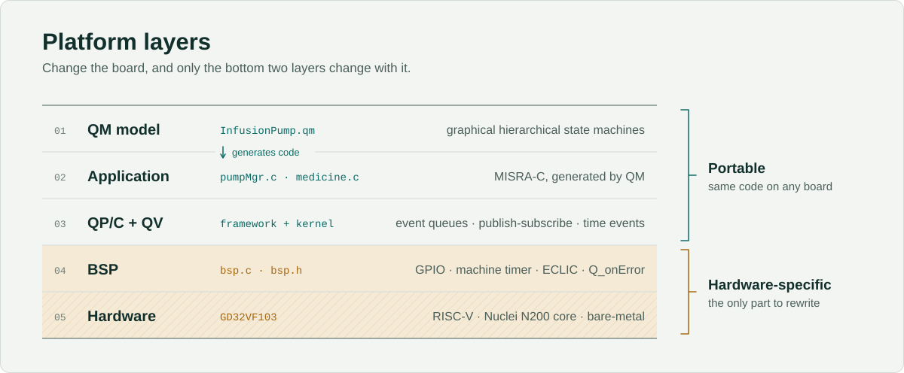

You design the behavior as state machines in **QM**, and QM generates the C code. The code runs on the **QP/C** framework, scheduled by the **QV** kernel. A thin **Board Support Package** connects it to the hardware. Moving to another board only means rewriting the BSP.

## No shared memory, no mutexes


<table>
  <tr>
    <td width="55%" valign="top">

**Run-to-completion**

QV runs the active objects one at a time in a single thread. Each event is handled from start to finish before the next one starts, so an event is never interrupted by another event in the same context.

✅ **No race conditions:** objects never touch each other's data<br>
✅ **No deadlocks:** nothing ever waits on a lock<br>
✅ **Predictable:** easy to reason about, easy to test

  </td>
    <td width="45%" align="center">
      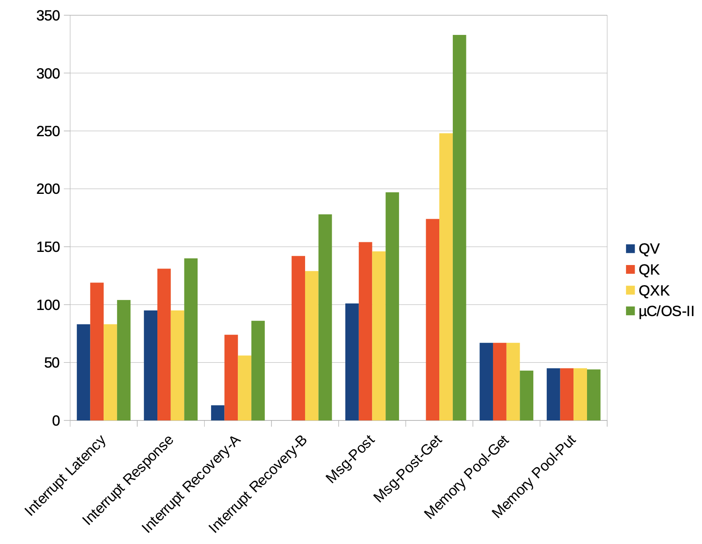<br>
      <sub>QP kernels vs µC/OS-II. Lower is better.<br>Data: <a href="https://www.state-machine.com/doc/AN_QP_Performance.pdf">Quantum Leaps</a></sub>
    </td>
  </tr>
</table>

## From model to code

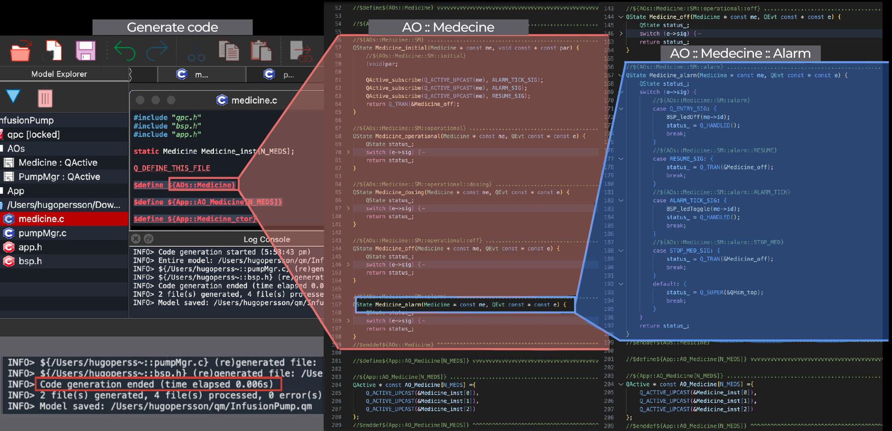

Click **Generate code**, and QM fills in each `$define` in `medicine.c` with real C code. The red box is the whole Medicine active object; the blue box zooms in on its `alarm` state. Generating code for the whole infusion pump took **0.006 s**.

<details>
<summary><h3>The QM editor · click to open</h3></summary>
<br>

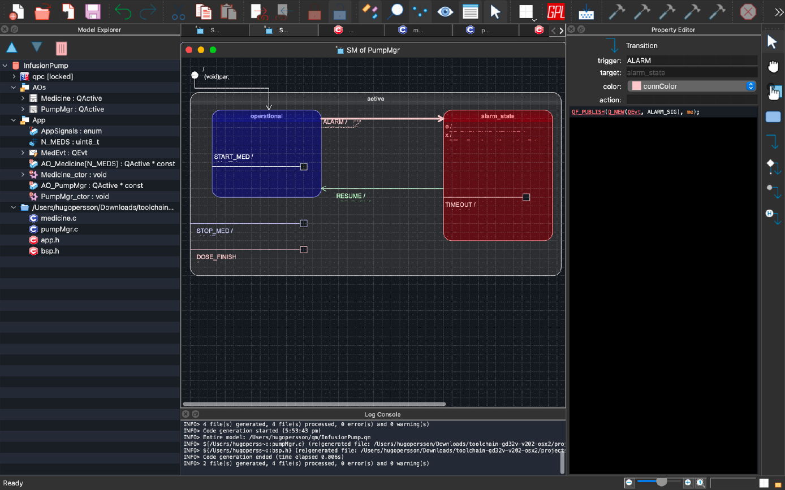

<sub>QM with the PumpMgr state machine open. The Model Explorer (left) lists the active objects, signals and generated files. The Property Editor (right) shows the action for the selected <code>ALARM</code> transition: <code>QF_PUBLISH(Q_NEW(QEvt, ALARM_SIG), me);</code></sub>

<table>
  <tr>
    <td width="45%" align="center">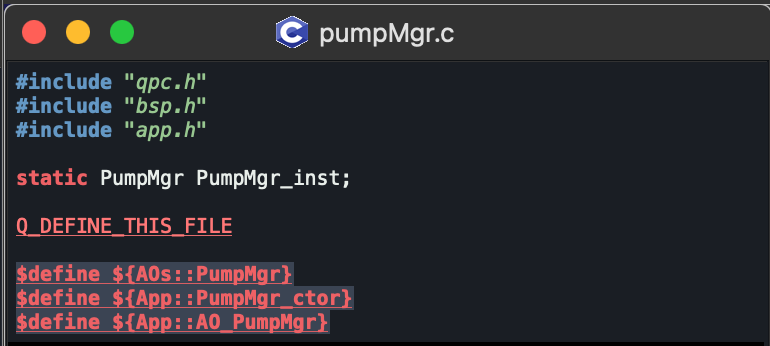<br><sub>The file template: QM inserts the generated code at each <code>$define</code></sub></td>
    <td width="55%" align="center">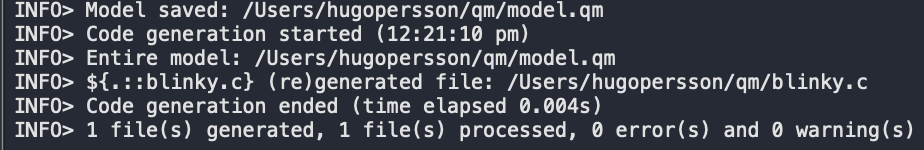<br><sub>The first port, Blinky, generated in 0.004 s</sub></td>
  </tr>
</table>

</details>

</details>

---

<a id="the-demo"></a>
<details>
<summary><h1>💉 The demo: an infusion pump</h1></summary>
<br>

To show the whole workflow, we built a **simulated infusion pump** with three medicine dosing channels and a safety alarm. Switches stand in for user input, and LEDs show which medicines are dosing.

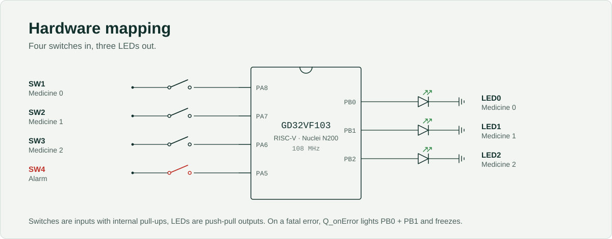


<table>
  <tr>
    <td width="50%" valign="top">

**PumpMgr**: the control system

- Superstate `active` with two substates
- `operational`: forwards `START_MED` to the right medicine
- `alarm_state`: entered on `ALARM`, which it publishes to every medicine
- `RESUME` restarts the medicines that were running

  </td>
    <td width="50%" valign="top">

**Medicine[0..2]**: one per channel

- Superstate `operational` with `off` and `dosing`
- `START_MED`: off → dosing, LED on
- `STOP_MED`: dosing → off, LED off
- Subscribes to `ALARM`: goes to its `alarm` state, where the LED blinks on every alarm tick

  </td>
  </tr>
</table>

<details>
<summary><h3>The alarm, step by step · click to open</h3></summary>
<br>

1. **Trigger.** Switch 4 (PA5) is flipped. The timer ISR detects the edge and posts `ALARM_SIG` to PumpMgr.
2. **Publish.** PumpMgr publishes `ALARM_SIG`. Every Medicine subscribes to it, so they all react at once and stop dosing.
3. **Safe state.** PumpMgr moves to `alarm_state` and sends periodic alarm ticks to the medicines that were running. Their LEDs start blinking, so you can see which doses were interrupted.
4. **Resume.** Switching the alarm off publishes `RESUME_SIG`, and the medicines that were running go back to dosing.

</details>

</details>

---

<a id="risc-v-port"></a>
<details>
<summary><h1>🔧 Porting QP/C to RISC-V</h1></summary>
<br>

The QP/C port file (`qp_port.h`) takes care of the framework internals. All we had to write was the **BSP**, which gives the framework a heartbeat and connects it to the pins.


| Function | What it does |
|---|---|
| `BSP_init()` | Enables the GPIO clocks and sets up the switches (pull-up inputs) and LEDs (push-pull outputs) |
| `QF_onStartup()` | Enables the timer interrupt in the **ECLIC** and schedules the first tick |
| `eclic_mtip_handler()` | The 100 Hz tick: reschedules itself, drives QP time events, and reads the switches with edge detection |
| `QV_onIdle()` | Re-enables interrupts while the system is idle |
| `Q_onError()` | Global fault handler: disables interrupts, lights PB0 + PB1, and freezes in a safe state |

<details>
<summary><h3>The timer interrupt in code · click to open</h3></summary>
<br>

```c
void eclic_mtip_handler(void) {
    uint32_t tick_step = TIMER_FREQ / BSP_TICKS_PER_SEC;          // 270 000 cycles
    uint64_t next_tick = *(uint64_t volatile *)(TIMER_CTRL_ADDR + TIMER_MTIME);
    *(uint64_t volatile *)(TIMER_CTRL_ADDR + TIMER_MTIMECMP) = next_tick + tick_step;

    QTIMEEVT_TICK_X(0U, (void *)0);                                // drive QP time events

    /* ... read PA8-PA5, detect edges, post events to PumpMgr ... */
}
```

The full BSP is in [`InfusionsPump/bsp.c`](InfusionsPump/bsp.c) and in Appendix B of the thesis.

</details>

</details>

---

<a id="results"></a>
<details>
<summary><h1>📊 Results</h1></summary>
<br>

Porting QP/C to RISC-V, combined with QM, gave a **working platform**. The infusion pump runs on the GD32VF103 as modeled.

<table>
  <tr>
    <td align="center" width="25%"><h2>0.006&nbsp;s</h2><sub>to generate the infusion pump code from the model</sub></td>
    <td align="center" width="25%"><h2>0</h2><sub>mutexes or shared resources in the application</sub></td>
    <td align="center" width="25%"><h2>1</h2><sub>layer to rewrite for new hardware: the BSP</sub></td>
    <td align="center" width="25%"><h2>100&nbsp;Hz</h2><sub>system tick from the RISC-V machine timer</sub></td>
  </tr>
</table>

## Three takeaways

<table>
  <tr>
    <td align="center" width="33%"><h3>1.</h3><b>Automated code generation</b><br><sub>Design in QM, generate MISRA-C, and change the model instead of the code.</sub></td>
    <td align="center" width="33%"><h3>2.</h3><b>An event-driven framework instead of an RTOS</b><br><sub>Active objects and run-to-completion remove whole classes of concurrency bugs.</sub></td>
    <td align="center" width="33%"><h3>3.</h3><b>An easier path to certification</b><br><sub>A documented framework gives the end product a head start on the standards.</sub></td>
  </tr>
</table>

## Working towards standards

| Platform feature | Supports |
|---|---|
| 🧱 Active objects: strict software partitioning | **IEC 62304** modular architecture · **ISO 26262** Freedom From Interference |
| 📣 Publish-subscribe alarm: every unit reacts at once | Predictable, safe-state behavior |
| 🛑 `Q_onError`: interrupts off, system frozen | **IEC 61508** functional safety |
| 🖱️ QM-generated MISRA-C code | Less manual coding, fewer systematic errors |

> ⚠️ **Note:** QP/C is a *Software Element out of Context* (SEooC). Its documentation helps a product work towards the standards, but the framework alone **cannot guarantee** that an end product complies. This is an academic proof of concept, **not a certified medical device**.

</details>

---

<a id="get-started"></a>
<details>
<summary><h1>🚀 Get started</h1></summary>
<br>

**You need:** a GD32VF103 board, 4 switches and 3 LEDs, a RISC-V GCC toolchain with the GD32VF103 / Nuclei SDK libraries (we used the `toolchain-gd32v` package, v2.0.2), and [QM](https://www.state-machine.com/products/qm) 7.x to edit the models. QP/C 8.x is included in the `qpc/` folders.

```bash
git clone https://github.com/HugoPersson01/qp_RISCV_implementation.git
cd qp_RISCV_implementation/InfusionsPump
make
```

<!-- TODO: add the toolchain prefix, SDK path and flashing command (e.g. OpenOCD / dfu-util) -->

## Changing the behavior


Open `InfusionsPump/qm/InfusionPump.qm` in QM, change the state machines, and click **Generate Code**. Then build and flash again.

> ⚠️ **Warning:** Don't edit `pumpMgr.c` or `medicine.c` by hand. QM overwrites them the next time it generates code.

</details>

---

<a id="roadmap"></a>
<details>
<summary><h1>🧭 Limitations and roadmap</h1></summary>
<br>

<table>
  <tr>
    <td width="45%" valign="top">

**Known limitations**

- The pump is a simulation: switches and LEDs, no real motor or sensors
- Base QP/C is not safety-certified on its own
- No real-time tracing during development
- A long learning curve to use the tools correctly

  </td>
    <td width="55%" valign="top">

### Next steps
- [ ] **SafeQP/C:** ready-made certification artifacts, and the same API, so no code changes
- [ ] **QP/Spy:** real-time tracing for easier debugging and better documentation
- [ ] **QUTest:** automated tests driven from the host

### Longer term
- [ ] **Real actuators** in place of the LEDs
- [ ] **More devices** on the same platform, such as pacemakers or glucose meters

  </td>
  </tr>
</table>

</details>

---

<a id="repository"></a>
<details>
<summary><h1>📁 Repository</h1></summary>
<br>

<pre>
qp_RISCV_implementation/
├── <a href="README.md">README.md</a>                      ← this page
├── <a href="InfusionsPump/">InfusionsPump/</a>                 ← the infusion pump demo
│   ├── <a href="InfusionsPump/qm/">qm/</a>                        ← QM model (InfusionPump.qm)
│   ├── <a href="InfusionsPump/qpc/">qpc/</a>                       ← QP/C framework + RISC-V port
│   ├── <a href="InfusionsPump/app.h">app.h</a>                      ← signals, events, active objects
│   ├── <a href="InfusionsPump/bsp.c">bsp.c</a> / <a href="InfusionsPump/bsp.h">bsp.h</a>              ← Board Support Package
│   ├── <a href="InfusionsPump/main.c">main.c</a>                     ← starts the active objects
│   ├── <a href="InfusionsPump/pumpMgr.c">pumpMgr.c</a>                  ← generated by QM
│   ├── <a href="InfusionsPump/medicine.c">medicine.c</a>                 ← generated by QM
│   └── <a href="InfusionsPump/Makefile">Makefile</a>
├── <a href="QProjects/">QProjects/</a>                     ← first port: Blinky
│   ├── <a href="QProjects/bsp/">bsp/</a>
│   ├── <a href="QProjects/qpc/">qpc/</a>
│   ├── <a href="QProjects/Blinky.c">Blinky.c</a>                   ← two states: LED on / LED off
│   └── <a href="QProjects/Makefile">Makefile</a>
├── <a href="Preliminary%20report/">Preliminary report/</a>
│   ├── <a href="Preliminary%20report/Examensarbete.pdf">Examensarbete.pdf</a>          ← the thesis
│   └── <a href="Preliminary%20report/Presentation.pdf">Presentation.pdf</a>           ← slides from the presentation
└── <a href="docs/images/">docs/images/</a>
    ├── <a href="docs/images/readme/">readme/</a>                    ← banners and diagrams
    ├── <a href="docs/images/thesis/">thesis/</a>                    ← figures from the thesis
    └── <a href="docs/images/presentation/">presentation/</a>              ← screenshots from the slides
</pre>

| Path | What's inside |
|---|---|
| [`InfusionsPump/`](InfusionsPump/) | The full demo application. Start with `app.h` to see the signals and active objects. |
| [`InfusionsPump/qm/`](InfusionsPump/qm/) | The QM model. Open it in QM to see and edit the state machines. |
| [`InfusionsPump/bsp.c`](InfusionsPump/bsp.c) | The only hardware-specific code: GPIO, timer, interrupts and the fault handler. |
| [`QProjects/`](QProjects/) | Quantum Leaps' Blinky example, ported first to bring up the framework, timer and BSP. |
| [`Preliminary report/`](Preliminary%20report/) | The thesis (in Swedish, with an English abstract) and the presentation slides. |

</details>

---

<a id="team"></a>
<details>
<summary><h1>👥 Team</h1></summary>
<br>

<table>
  <tr>
    <td align="center" width="50%">
      <a href="https://github.com/HugoPersson01"><br><b>Hugo Persson</b></a>
    </td>
    <td align="center" width="50%">
      <a href="https://github.com/ThrainnLeo"><br><b>Thrainn Leo Thorisson</b></a>
    </td>
  </tr>
</table>

**Supervisor:** Olof Forsberg (KTH) · **Examiner:** Dmitry Grishenkov<br>
Bachelor's thesis in Medical Engineering, 15 credits · KTH Royal Institute of Technology · TRITA-CBH-GRU-2026:308

Framework and tools by [Quantum Leaps](https://www.state-machine.com/).

<details>
<summary><h3>License · click to open</h3></summary>
<br>

QP/C and the code QM generates are licensed by Quantum Leaps under **GPL-3.0-or-later**. Closed-source or commercial use needs a commercial license from [Quantum Leaps](https://www.state-machine.com/licensing).

</details>

</details>
