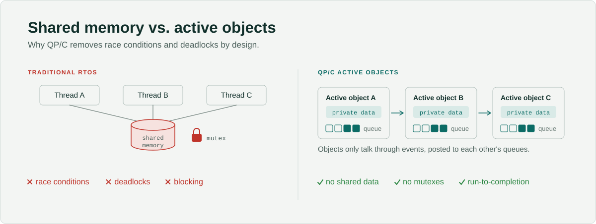
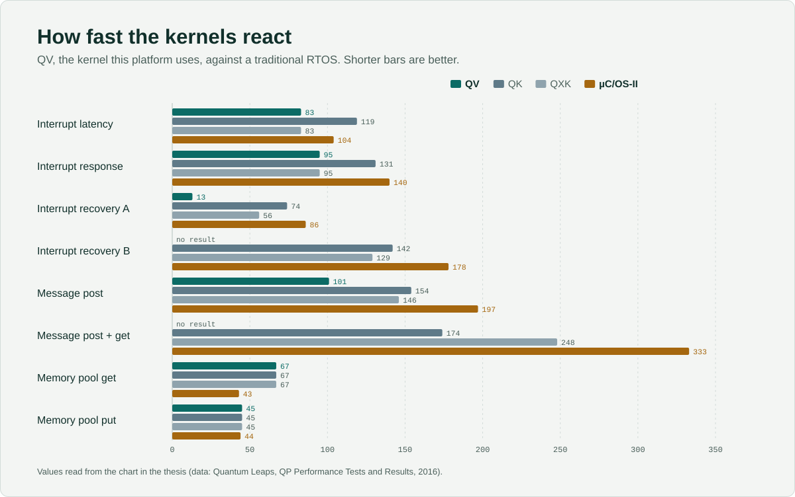
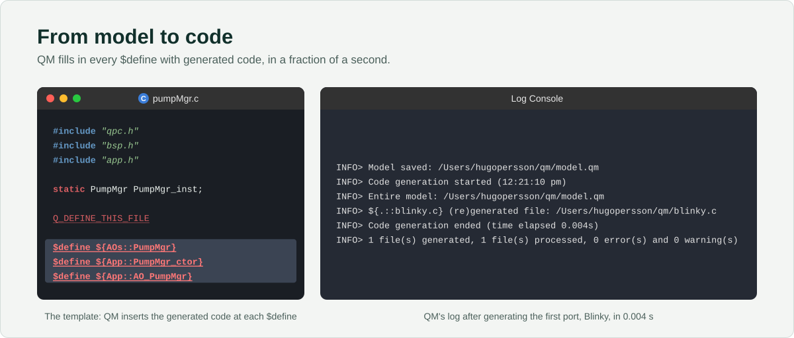
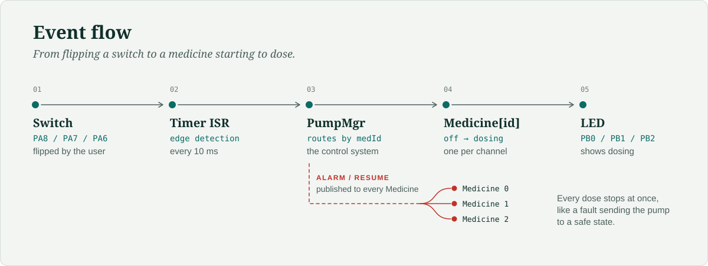
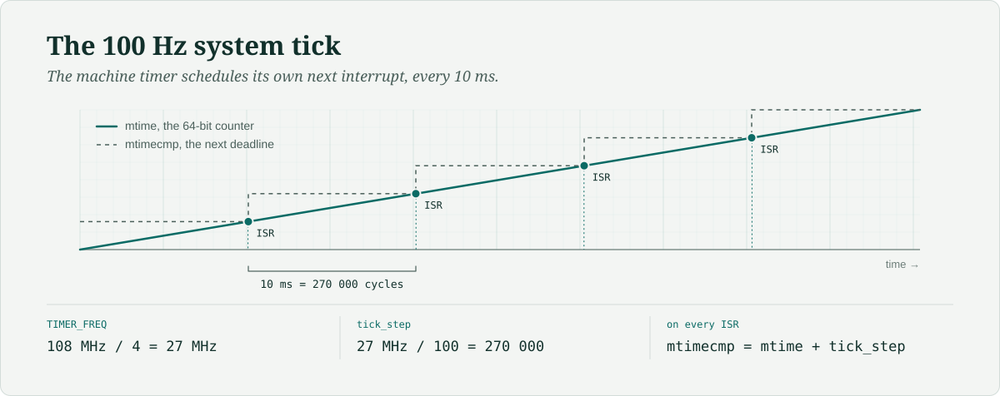
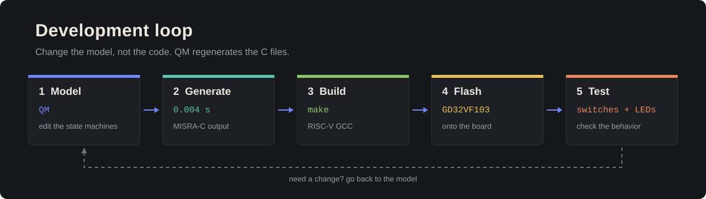

<div align="center">


**[Read the thesis](Preliminary%20report/Examensarbete.pdf)** &nbsp;


</div>


> ### *"Don't let AI write code you don't understand. Instead, describe the design in a formal language and generate the code from it, so the code can be formally approved."*

That's the idea behind this platform. The **QM model is the formal design**, the C code is generated from it, and you always know why the code does what it does.

<sub>Click a section to open it.</sub>

---

<details>
<summary><h2>Why this platform?</h2></summary>
<br>

Medical devices range from a plaster to a ventilator, and a software fault in one can be life-threatening. So regulations and international standards control how they are built, and every prototype is tested, documented and verified against them. That process is **slow and expensive**, and hand-written concurrent code makes it harder still, because race conditions and deadlocks are easy to write and hard to find.

> ℹ️ **Research question:** Can a platform make medical device development easier, by automating parts of the process without compromising safety?

The platform combines three tools:

| Tool | What it does | Why we chose it |
|---|---|---|
| **QP/C** + **QV** | Event framework built on *active objects*, with a run-to-completion kernel | No shared memory, so no mutexes. QV reacts quickly to interrupts. License-free, unlike SafeQP/C |
| **QM** | Graphical modeler for hierarchical state machines | Generates MISRA-C code. You change the model, not the code |
| **RISC-V** (GD32VF103) | Microcontroller running bare-metal, with no OS | Open and license-free, growing in industry, and simple to port to |

</details>

---

<details>
<summary><h2>How it works</h2></summary>
<br>


You design the behavior as state machines in **QM**, and QM generates the C code. That code runs on the **QP/C** framework, scheduled by the **QV** kernel. A thin **Board Support Package** connects everything to the hardware.



**Run-to-completion.** QV runs the active objects one at a time, in a single thread. Each event is handled from start to finish before the next one starts, so one event never interrupts another in the same context. That rules out race conditions, nothing ever waits on a lock, and the behavior stays predictable and easy to test.





QM writes the C files for you. Each file starts as a small template, and every `$define` line marks where QM inserts the generated code. Generating the whole infusion pump took **0.006 s**.

</details>

---

<details>
<summary><h2>The demo: an infusion pump</h2></summary>
<br>

To show the whole workflow, we built a **simulated infusion pump** with three dosing channels and a safety alarm. Switches stand in for user input, and LEDs show which medicines are dosing.




### The two state machines

<table>
  <tr>
    <td width="50%" valign="top">

**PumpMgr**, the control system

- `operational` forwards `START_MED` to the right medicine
- `alarm_state` is entered on `ALARM`, which it publishes to every medicine
- `RESUME` restarts the medicines that were running

  </td>
    <td width="50%" valign="top">

**Medicine[0..2]**, one per channel

- `START_MED` turns `off` into `dosing`, and the LED on
- `STOP_MED` goes back to `off`
- On `ALARM` it goes to `alarm`, where the LED blinks on every alarm tick

  </td>
  </tr>
</table>

<details>
<summary><b>The alarm, step by step</b></summary>
<br>

1. **Trigger.** Switch 4 (PA5) is flipped. The timer ISR detects the edge and posts `ALARM_SIG` to PumpMgr.
2. **Publish.** PumpMgr publishes `ALARM_SIG`. Every Medicine subscribes to it, so they all stop dosing at once.
3. **Safe state.** PumpMgr moves to `alarm_state` and sends periodic alarm ticks to the medicines that were running. Their LEDs blink, so you can see which doses were interrupted.
4. **Resume.** Switching the alarm off publishes `RESUME_SIG`, and the interrupted doses start again.

</details>

</details>

---

<details>
<summary><h2>Porting QP/C to RISC-V</h2></summary>
<br>

The QP/C port file (`qp_port.h`) handles the framework internals. All we had to write was the **BSP**, which gives the framework a heartbeat and connects it to the pins.



| Function | What it does |
|---|---|
| `BSP_init()` | Enables the GPIO clocks and sets up the switches (pull-up inputs) and LEDs (push-pull outputs) |
| `QF_onStartup()` | Enables the timer interrupt in the **ECLIC** and schedules the first tick |
| `eclic_mtip_handler()` | The 100 Hz tick: reschedules itself, drives QP time events, and reads the switches with edge detection |
| `QV_onIdle()` | Re-enables interrupts while the system is idle |
| `Q_onError()` | Global fault handler: disables interrupts, lights PB0 + PB1, and freezes in a safe state |

<details>
<summary><b>The timer interrupt in code</b></summary>
<br>

```c
void eclic_mtip_handler(void) {
    uint32_t tick_step = TIMER_FREQ / BSP_TICKS_PER_SEC;          // 270 000 cycles
    uint64_t next_tick = *(uint64_t volatile *)(TIMER_CTRL_ADDR + TIMER_MTIME);
    *(uint64_t volatile *)(TIMER_CTRL_ADDR + TIMER_MTIMECMP) = next_tick + tick_step;

    QTIMEEVT_TICK_X(0U, (void *)0);                                // drive QP time events

    /* ... read PA8-PA5, detect edges, post events to PumpMgr ... */
}
```

The full BSP is in [`InfusionsPump/bsp.c`](InfusionsPump/bsp.c) and in Appendix B of the thesis.

</details>

</details>

---

<details>
<summary><h2>Results</h2></summary>
<br>

Porting QP/C to RISC-V and combining it with QM gave a **working platform**: the infusion pump runs on the GD32VF103 exactly as modeled. QM generated its code in **0.006 s**, the application has **no mutexes or shared resources**, and moving to new hardware means rewriting **one layer**, the BSP.

We see three main contributions:

1. **Automated code generation.** You design in QM, generate MISRA-C, and change the model instead of the code.
2. **An event-driven framework instead of a traditional RTOS.** Active objects and run-to-completion remove whole classes of concurrency bugs.
3. **An easier path to certification.** A documented framework gives the end product a head start on the standards.

### Working towards standards

| Platform feature | Supports |
|---|---|
| Active objects: strict software partitioning | **IEC 62304** modular architecture, **ISO 26262** Freedom From Interference |
| Publish-subscribe alarm: every unit reacts at once | Predictable, safe-state behavior |
| `Q_onError`: interrupts off, system frozen | **IEC 61508** functional safety |
| QM-generated MISRA-C code | Less manual coding, fewer systematic errors |

> ⚠️ **Note:** QP/C is a *Software Element out of Context* (SEooC). Its documentation helps a product work towards the standards, but the framework alone cannot guarantee that an end product complies. This is an academic proof of concept, **not a certified medical device**.

</details>

---

<details>
<summary><h2>Get started</h2></summary>
<br>

You need a GD32VF103 board, 4 switches and 3 LEDs, a RISC-V GCC toolchain with the GD32VF103 / Nuclei SDK libraries (we used the `toolchain-gd32v` package, v2.0.2), and [QM](https://www.state-machine.com/products/qm) 7.x to edit the models. QP/C 8.x is included in the `qpc/` folders.

```bash
git clone https://github.com/HugoPersson01/qp_RISCV_implementation.git
cd qp_RISCV_implementation/InfusionsPump
make
```

<!-- TODO: add the toolchain prefix, SDK path and flashing command (e.g. OpenOCD / dfu-util) -->



To change the behavior, open `InfusionsPump/qm/InfusionPump.qm` in QM, edit the state machines, and click **Generate Code**. Then build and flash again.

> ⚠️ **Warning:** Don't edit `pumpMgr.c` or `medicine.c` by hand. QM overwrites them the next time it generates code.

</details>

---

<details>
<summary><h2>Limitations and roadmap</h2></summary>
<br>

**Known limitations**

- The pump is a simulation: switches and LEDs, no real motor or sensors
- Base QP/C is not safety-certified on its own
- No real-time tracing during development
- The tools take time to learn to use correctly

**Next steps**

- [ ] **SafeQP/C:** ready-made certification artifacts, with the same API, so no code changes

- [ ] **QP/Spy:** real-time tracing for easier debugging and better documentation

- [ ] **QUTest:** automated tests driven from the host

**Longer term**

- [ ] **Real actuators** in place of the LEDs

- [ ] **More devices** on the same platform, such as pacemakers or glucose meters

</details>

---

<details>
<summary><h2>Repository</h2></summary>
<br>

<pre>
qp_RISCV_implementation/
├── <a href="README.md">README.md</a>               ← this page
├── <a href="InfusionsPump/">InfusionsPump/</a>          ← the infusion pump demo
│   ├── <a href="InfusionsPump/qm/">qm/</a>                 ← QM model: open it in QM to edit the state machines
│   ├── <a href="InfusionsPump/qpc/">qpc/</a>                ← QP/C framework + RISC-V port
│   ├── <a href="InfusionsPump/app.h">app.h</a>               ← start here: signals, events, active objects
│   ├── <a href="InfusionsPump/bsp.c">bsp.c</a> / <a href="InfusionsPump/bsp.h">bsp.h</a>       ← the only hardware-specific code
│   ├── <a href="InfusionsPump/main.c">main.c</a>              ← starts the active objects
│   ├── <a href="InfusionsPump/pumpMgr.c">pumpMgr.c</a>           ← generated by QM, don't edit
│   ├── <a href="InfusionsPump/medicine.c">medicine.c</a>          ← generated by QM, don't edit
│   └── <a href="InfusionsPump/Makefile">Makefile</a>
├── <a href="QProjects/">QProjects/</a>              ← first port: Quantum Leaps' Blinky example
│   ├── <a href="QProjects/bsp/">bsp/</a>
│   ├── <a href="QProjects/qpc/">qpc/</a>
│   ├── <a href="QProjects/Blinky.c">Blinky.c</a>            ← two states: LED on / LED off
│   └── <a href="QProjects/Makefile">Makefile</a>
├── <a href="Preliminary%20report/">Preliminary report/</a>
│   ├── <a href="Preliminary%20report/Examensarbete.pdf">Examensarbete.pdf</a>   ← the thesis (Swedish, English abstract)
│   └── <a href="Preliminary%20report/Presentation.pdf">Presentation.pdf</a>    ← slides from the presentation
└── <a href="docs/">docs/</a>
    ├── <a href="docs/DESIGN.md">DESIGN.md</a>           ← colors, type and rules for the banners
    └── <a href="docs/images/">images/</a>             ← banners and diagrams
</pre>

</details>

---

<details>
<summary><h2>Team</h2></summary>
<br>

<table>
  <tr>
    <td align="center" width="50%">
      <a href="https://github.com/HugoPersson01"><br><b>Hugo Persson</b></a>
    </td>
    <td align="center" width="50%">
      <a href="https://github.com/ThrainnLeo"><br><b>Thrainn Leo Thorisson</b></a>
    </td>
  </tr>
</table>

**Supervisor:** Olof Forsberg (KTH) · **Examiner:** Dmitry Grishenkov<br>
Bachelor's thesis in Medical Engineering, 15 credits · KTH Royal Institute of Technology · TRITA-CBH-GRU-2026:308

Framework and tools by [Quantum Leaps](https://www.state-machine.com/).

<details>
<summary><b>License</b></summary>
<br>

QP/C and the code QM generates are licensed by Quantum Leaps under **GPL-3.0-or-later**. Closed-source or commercial use needs a commercial license from [Quantum Leaps](https://www.state-machine.com/licensing).

</details>

</details>
